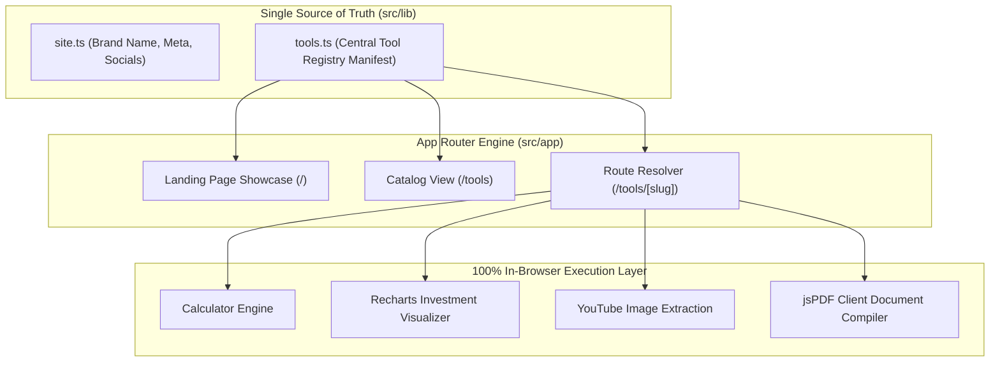

# ToolHub: Open-Source Privacy-First Online Tools Suite

<div align="center">

[](https://github.com/codewithmuh/aiseekho-websites/releases)
[](https://opensource.org/licenses/MIT)
[](https://github.com/codewithmuh/aiseekho-websites/stargazers)
[](https://github.com/codewithmuh/aiseekho-websites/network/members)
[](https://nextjs.org/)
[](https://react.dev/)
[](https://tailwindcss.com/)
[](https://ui.shadcn.com/)
[](https://www.youtube.com/@codewithmuh)

**A modular, privacy-friendly online web tools platform running 100% in the client browser with zero backend costs. Features keyboard calculator, investment growth projection charts, YouTube thumbnail grabber, and instant client-side PDF invoice generator.**

[Included Tools](#tools-included) • [Registry Architecture](#registry--execution-architecture) • [Tech Stack](#tech-stack) • [Quick Start](#getting-started) • [Adding New Tools](#adding-a-new-tool) • [Deployment](#deploying-to-vercel)

</div>

---

## Overview

**ToolHub** is a clean, modern web application delivering essential everyday utilities with strict user privacy. Because every calculation, thumbnail extraction, and PDF compilation occurs strictly inside the browser runtime, there are **no database costs, no API keys, and zero tracking**.

---

## Tools Included

| Tool | Route | Functionality | Client Technologies |
|---|---|---|---|
| 🧮 **Calculator** | `/tools/calculator` | Full keyboard-friendly arithmetic, percent calculations, and precision decimals. | Native React State |
| 📈 **Investment & ROI Calculator** | `/tools/investment-calculator` | Interactive compound growth projections with dynamic visual charts. | Recharts Visualizer |
| 🖼️ **YouTube Thumbnail Downloader**| `/tools/youtube-thumbnail` | Multi-resolution YouTube thumbnail scraper (`maxres`, `hq`, `mq`). | Client-side Canvas API |
| 📄 **Invoice Generator** | `/tools/invoice-generator` | Professional invoice layout with live preview and instant vector PDF export. | jsPDF + AutoTable |

---

## Registry & Execution Architecture



---

## Tech Stack

- **Framework:** Next.js 16 (App Router) + React 19 + TypeScript
- **Styling:** Tailwind CSS v4 + PostCSS
- **Component Primitives:** shadcn/ui + Lucide React Icons
- **Data Visualization:** Recharts
- **Document Generation:** jsPDF + jsPDF-AutoTable
- **Hosting:** Static SSG / Vercel Edge Network

---

## Getting Started

### Prerequisites

- [Node.js](https://nodejs.org/) (v20+ recommended)
- [npm](https://www.npmjs.com/)

### Installation & Run

```bash
# Clone the repository
git clone https://github.com/codewithmuh/aiseekho-websites.git
cd aiseekho-websites

# Install dependencies
npm install

# Start development server
npm run dev
```

Open [http://localhost:3000](http://localhost:3000) to view the tool portal.

---

## Adding a New Tool in 3 Steps

The application is structured around a central registry so adding a new utility takes only minutes:

1. **Build the Interactive UI:** Create `src/components/tools/<tool-name>.tsx` (marked with `"use client"`).
2. **Define Route Shell:** Create `src/app/tools/<slug>/page.tsx` and wrap your component with `<ToolPageShell>`.
3. **Register Manifest:** Add the tool entry to `tools` in [`src/lib/tools.ts`](src/lib/tools.ts):
   ```typescript
   {
     slug: "currency-converter",
     name: "Currency Converter",
     description: "Convert global exchange rates instantly.",
     icon: "coins",
     category: "finance",
     keywords: ["forex", "money", "currency"]
   }
   ```
The tool automatically renders across the homepage showcase, `/tools` catalog, and navigation menus.

---

## Deploying to Vercel

ToolHub requires zero backend servers or secret environment keys:

1. Push your changes to GitHub.
2. Import the repository into [Vercel](https://vercel.com/new).
3. Vercel automatically detects Next.js and builds the static bundle.
4. Update `url` in `src/lib/site.ts` with your custom production domain.

---

## License

This project is licensed under the [MIT License](LICENSE).
